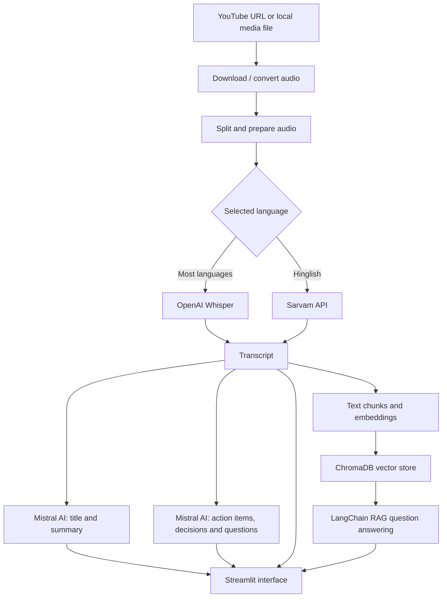

# 🎬 VisiScope — AI Video & Meeting Assistant

<p align="center">
  <strong>Turn long videos, lectures, podcasts, and meeting recordings into information you can actually use.</strong>
</p>

<p align="center">
  
  
  
  
  
</p>

---

## ✨ What is VisiScope?

VisiScope is an AI-powered video and meeting assistant built with Python and Streamlit. Give it a YouTube link or the path to a local audio/video file, choose a transcription language, and let it turn the recording into a searchable knowledge source.

Instead of watching or listening to an entire recording again, you can quickly review its summary, find decisions and action items, and ask questions about what was said.

## 🚀 What can it do?

| Feature | What it does |
|---|---|
| 🎥 Video/audio input | Processes a YouTube URL or a local media file path. |
| 🗣️ Transcription | Converts speech into text using OpenAI Whisper; Hinglish uses Sarvam's speech-to-text/translation API. |
| 🌐 Language selection | Supports automatic language detection and a range of Whisper languages, plus a dedicated Hinglish option. |
| 📝 Smart summary | Creates a concise, structured summary of the recording. |
| 📌 Action items | Extracts tasks, responsible people (when mentioned), and deadlines (when mentioned). |
| ✅ Key decisions | Highlights decisions made during the discussion. |
| ❓ Open questions | Finds unresolved questions and topics that may need follow-up. |
| 💬 Ask the recording | Lets you ask natural-language questions using a Retrieval-Augmented Generation (RAG) pipeline. |

## 🧭 How to use it

1. **Provide a source:** paste a YouTube URL or enter the absolute path of a local audio/video file in the sidebar.
2. **Choose a language:** select Auto Detect, a supported language, or Hinglish.
3. **Analyse:** start the pipeline and allow the audio processing and transcription steps to finish.
4. **Explore the results:** review the generated title, transcript, summary, action items, decisions, and open questions.
5. **Chat with your content:** ask a question about the processed recording. The assistant retrieves relevant transcript sections to form its answer.

> 💡 **Example questions**
> - What were the main topics discussed?
> - Which action items were assigned, and to whom?
> - What decisions were made?
> - What questions are still unresolved?
> - What did the speaker say about the project deadline?

## 🏗️ How it works



### Under the hood

- **Media processing:** `yt-dlp` downloads YouTube audio; FFmpeg and PyDub help convert and prepare media as 16 kHz mono WAV audio.
- **Transcription:** Whisper runs locally for supported language selections. The Hinglish option sends short audio pieces to Sarvam's API for transcription/translation.
- **LLM tasks:** LangChain connects the application to Mistral (`mistral-small-latest`) for summarisation, title generation, information extraction, and question answering.
- **Semantic retrieval:** the transcript is split into smaller chunks, embedded with the `all-MiniLM-L6-v2` Hugging Face model, and stored in ChromaDB. The RAG chain retrieves relevant chunks before answering.
- **Interface:** Streamlit provides the application UI and processing workflow.

## 🧰 Tech stack

| Area | Tools |
|---|---|
| Language | Python 3.11+ |
| User interface | Streamlit, custom CSS |
| Speech recognition | OpenAI Whisper |
| Hinglish transcription/translation | Sarvam AI API |
| LLM | Mistral AI (`mistral-small-latest`) |
| Orchestration | LangChain |
| Embeddings | Hugging Face Sentence Transformers (`all-MiniLM-L6-v2`) |
| Vector database | ChromaDB |
| Media download/conversion | yt-dlp, FFmpeg, PyDub |
| Configuration | python-dotenv |

## 📁 Project structure

```text
AI-VIDEO-ASSISTANT/
│
├── app.py                    # Main Streamlit application
├── main.py                   # Additional project entry point
├── requirements.txt          # Python dependencies
├── pyproject.toml            # Project metadata and dependencies
├── .env                      # Local API keys (create this yourself; do not commit)
│
├── core/
│   ├── transcriber.py        # Whisper and Sarvam transcription logic
│   ├── summarizer.py         # Meeting title and summary generation
│   ├── extractor.py          # Action items, decisions and questions
│   ├── rag_engine.py         # Retrieval-augmented question answering
│   └── vector_store.py       # Embeddings and ChromaDB operations
│
├── utils/
│   └── audio_processor.py    # Downloading, conversion and audio preparation
│
└── vector_db/                # Local ChromaDB data generated by the app
```

## ⚙️ Installation and setup

### 1. Clone the repository

```bash
git clone https://github.com/kunalmathiyan05/videoassistant.git
cd videoassistant
```

### 2. Create and activate a virtual environment

**Windows (PowerShell):**

```powershell
py -3.11 -m venv .venv
.venv\Scripts\Activate.ps1
```

**macOS / Linux:**

```bash
python3.11 -m venv .venv
source .venv/bin/activate
```

### 3. Install Python dependencies

```bash
python -m pip install --upgrade pip
pip install -r requirements.txt
```

### 4. Install FFmpeg

FFmpeg must be installed and available on your system so the application can process and convert media.

**Windows (using winget):**

```powershell
winget install Gyan.FFmpeg
```

**macOS (using Homebrew):**

```bash
brew install ffmpeg
```

**Ubuntu / Debian:**

```bash
sudo apt update && sudo apt install ffmpeg
```

Check that it is available:

```bash
ffmpeg -version
```

### 5. Add API keys

Create a file named `.env` in the project root. Add your own API keys:

```env
MISTRAL_API_KEY=your_mistral_api_key
SARVAM_API_KEY=your_sarvam_api_key
```

- `MISTRAL_API_KEY` is required for summaries, extraction, title generation, and RAG chat.
- `SARVAM_API_KEY` is required when you select the Hinglish transcription option.
- Whisper transcription does not require a Sarvam key.

**Important:** Never upload your `.env` file or expose API keys in screenshots, commits, or public issues. Keep credentials private.

### 6. Run the application

From the project root, run:

```bash
streamlit run app.py
```

Streamlit will print a local URL in the terminal (usually `http://localhost:8501`). Open that URL in your browser.

## 💬 Try asking

Once a recording has been analysed, try questions such as:

<details>
<summary>📋 Meeting and lecture questions</summary>

- Give me a short overview of this recording.
- List the most important points in order.
- What tasks were assigned? Include owners and deadlines if they were mentioned.
- Which decisions were finalised?
- What topics need further discussion?

</details>

<details>
<summary>🔎 Specific detail questions</summary>

- What was said about the budget?
- Was a delivery date mentioned?
- What risks or blockers were discussed?
- Did anyone suggest a solution for the issue?

</details>

## ⚠️ Notes and limitations

- Transcription and AI-generated outputs depend on audio quality, background noise, accents, and the selected language.
- Whisper models are downloaded locally when first used and may require substantial disk space and processing time. CPU transcription can be slow for long recordings.
- Mistral and Sarvam features require valid API credentials and internet access.
- The RAG assistant is designed to answer from the processed transcript. It may still misunderstand context, so verify important decisions, names, and deadlines against the original recording.
- Only process media that you have permission to access and use. Follow YouTube's terms and the applicable copyright rules.

## 🛣️ Possible future enhancements

- [ ] Speaker identification and diarization
- [ ] Export summaries and action items to PDF or DOCX
- [ ] Save and browse previous sessions
- [ ] Live meeting transcription
- [ ] User authentication and team workspaces
- [ ] Cloud deployment

## 🤝 Contributing

Suggestions, bug reports, and contributions are welcome!

1. Fork this repository.
2. Create a branch: `git checkout -b feature/your-feature`.
3. Make your changes and test them locally.
4. Commit: `git commit -m "Add: describe your change"`.
5. Push your branch: `git push origin feature/your-feature`.
6. Open a Pull Request with a clear explanation of the change.

## 👨‍💻 Author

**Kunal Mathiyan**  
GitHub: [@kunalmathiyan05](https://github.com/kunalmathiyan05)

---

<p align="center">
  If you find this project useful, consider giving the repository a ⭐ on GitHub!
</p>
